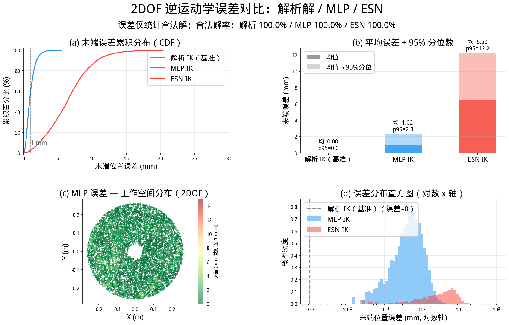
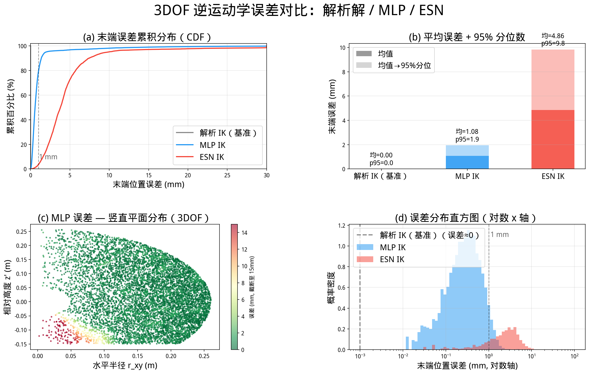
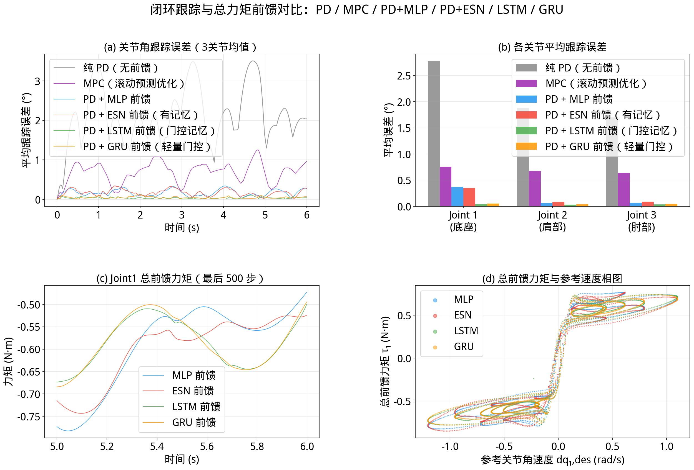

# 🤖 RobotARMNN — 机械臂神经网络运动学与逆动力学

[](https://www.python.org/)
[](https://pytorch.org/)
[](https://mujoco.org/)
[](LICENSE)

基于 **MuJoCo** 物理仿真的机械臂神经网络学习 Demo，包含两个完整实验模块：

| 模块 | 任务 | 网络 |
|------|------|------|
| 🦾 **逆运动学 (IK)** | 目标末端坐标 → 关节角（2-DOF 平面臂 + 3-DOF 空间臂） | MLP、ESN |
| ⚡ **逆动力学 (IDyn)** | 期望轨迹 → 前馈力矩（3-DOF 带摩擦空间臂） | MLP、ESN、LSTM、GRU |

### 🖼️ 演示结果一览

**逆运动学误差对比（2-DOF 平面臂）**


**逆运动学误差对比（3-DOF 空间臂）**


**逆动力学补偿效果对比（MLP / ESN / LSTM / GRU vs 纯 PD）**


---

## 📋 目录

- [🦿 机械臂构型](#机械臂构型)
- [📁 项目结构](#项目结构)
- [⚙️ 环境配置](#环境配置)
- [🚀 快速开始](#快速开始)
- [🦾 模块一：逆运动学 IK](#模块一逆运动学-ik)
- [⚡ 模块二：逆动力学 IDyn](#模块二逆动力学-idyn)
- [📊 训练结果](#训练结果)
- [🎮 可视化操作说明](#可视化操作说明)
- [🔬 技术细节](#技术细节)

---

## 🦿 机械臂构型

### 平面 2-DOF 臂

```
关节1 (θ1)：底座绕 Z 轴旋转（肩部）  范围 [-π, π]
关节2 (θ2)：肘部绕 Z 轴旋转（相对大臂）范围 [-π, π]
L1 = 0.15 m（大臂）  L2 = 0.12 m（小臂）
正运动学：X = L1·cos(θ1)+L2·cos(θ1+θ2)
         Y = L1·sin(θ1)+L2·sin(θ1+θ2)
可达半径：r_min = 0.03 m，r_max = 0.27 m
```

### 空间 3-DOF 臂

```
关节1 (θ1)：底座绕 Z 轴旋转
关节2 (θ2)：肩部绕 Y 轴俯仰   范围 [-π/2, π/2]
关节3 (θ3)：肘部绕 Y 轴俯仰   范围 [-π, π]
L0 = 0.20 m（底柱高度）  L1 = 0.15 m（大臂）  L2 = 0.12 m（小臂）
正运动学：r = L1·cos(θ2)+L2·cos(θ2+θ3)
         X = r·cos(θ1)，Y = r·sin(θ1)
         Z = L0+L1·sin(θ2)+L2·sin(θ2+θ3)
```

---

## 📁 项目结构

```
RobotARMNN/
│
├── src/                            # 所有源代码
│   ├── __init__.py
│   │
│   ├── # ─── 运动学 ───────────────────────────────
│   ├── kinematics_2dof.py          # 平面 2-DOF 正/逆运动学 + sin/cos 工具
│   ├── kinematics_3dof.py          # 空间 3-DOF 正/逆运动学（几何解耦法）
│   │
│   ├── # ─── MuJoCo 模型 ──────────────────────────
│   ├── arm_2dof.xml                # 平面臂 MJCF（含 mocap 目标球）
│   ├── arm_3dof.xml                # 空间臂 MJCF（含三轴标记）
│   ├── arm_3dof_friction.xml       # 带 Coulomb 摩擦的 3-DOF 臂（逆动力学用）
│   │
│   ├── # ─── 神经网络模型定义 ──────────────────────
│   ├── models.py                   # IKNN_MLP / IKNN_ESN / IDynMLP /
│   │                               # IDynESN / IDynLSTM / IDynGRU / CurrentNN
│   │
│   ├── # ─── 模块一：逆运动学 IK ───────────────────
│   ├── data_gen.py                 # IK 训练数据生成（随机采样工作空间，50 万点）
│   ├── train.py                    # IK 训练脚本（MLP + ESN，2-DOF + 3-DOF）
│   ├── visualize.py                # 🆕 可视化统一入口（子命令 ik / mujoco）
│   ├── visualize_mujoco.py         # MuJoCo 交互可视化（保留兼容）
│   ├── visualize_ik.py             # IK 误差对比图（保留兼容）
│   │
│   └── # ─── 模块二：逆动力学 IDyn ─────────────────
│       ├── data_gen_idyn.py        # IDyn 数据生成（MuJoCo 高刚度 PD 激励，30 条轨迹）
│       ├── train_idyn.py           # IDyn 训练脚本（MLP / ESN / LSTM / GRU）
        ├── mpc_controller.py       # 🆕 MPC 控制器（滚动预测优化 / 解析 QP，去除 scipy 迭代）
        └── visualize_idyn.py       # IDyn 控制误差对比图（PD/MPC/MPC+GRU/NN，自动保存）
│
├── tests/
│   ├── __init__.py
│   └── test_kinematics.py          # 18 项运动学单元测试
│
├── checkpoints/                    # 已训练模型权重（*.pt / *.npz）
│   ├── ik_2dof_mlp_best.pt         # 2-DOF IK MLP
│   ├── ik_2dof_esn_best.pt         # 2-DOF IK ESN
│   ├── ik_3dof_mlp_best.pt         # 3-DOF IK MLP
│   ├── ik_3dof_esn_best.pt         # 3-DOF IK ESN
│   ├── idyn_3dof_mlp_best.pt       # 3-DOF IDyn MLP
│   ├── idyn_3dof_esn_best.pt       # 3-DOF IDyn ESN
│   ├── idyn_3dof_lstm_best.pt      # 3-DOF IDyn LSTM
│   └── idyn_3dof_gru_best.pt       # 3-DOF IDyn GRU
│
├── data/                           # 训练数据（.gitignore 忽略，需自行生成）
├── export/                         # 可视化输出图片（.gitignore 忽略）
│
├── main.py                         # 快速入口：运动学解析演示
├── pyproject.toml                  # 依赖声明（uv 管理）
├── uv.lock                         # 依赖锁定文件
├── .python-version                 # Python 版本锁定（3.10）
├── LICENSE                         # MIT 许可证
└── README.md
```

---

## ⚙️ 环境配置

### 前置要求

| 依赖 | 版本 | 说明 |
|------|------|------|
| Python | 3.10 – 3.12 | 推荐 3.10 |
| uv | 最新版 | 替代 pip 的包管理器，速度快 10× |
| CUDA | 12.x （可选） | GPU 训练。无 CUDA 时自动退到 CPU |
| Git | ≥ 2.x | 克隆仓库 |

> **不需要手动创建虚拟环境**，`uv sync` 会自动创建并安装所有依赖。

---

### Linux / macOS

```bash
# 1. 安装 uv（若已安装可跳过）
curl -LsSf https://astral.sh/uv/install.sh | sh
source $HOME/.local/bin/env        # 或重开终端让 PATH 生效

# 2. 克隆项目
git clone https://github.com/Lijinzh/RobotARMNN.git
cd RobotARMNN

# 3. 初始化环境（自动创建 .venv，安装所有依赖）
uv sync

# 4. 验证安装
uv run python -c "import torch, mujoco; print('torch:', torch.__version__); print('mujoco:', mujoco.__version__)"
```

**MuJoCo 依赖（Linux）**：`apt install libgl1-mesa-glx libglu1-mesa`（已有桌面环境则无需）

---

### Windows

```powershell
# 1. 安装 uv（PowerShell，需要 Execution Policy 允许运行脚本）
powershell -ExecutionPolicy ByPass -c "irm https://astral.sh/uv/install.ps1 | iex"
# 或通过 winget：winget install --id=astral-sh.uv -e

# 2. 重开 PowerShell 让 PATH 生效，克隆项目
git clone https://github.com/Lijinzh/RobotARMNN.git
cd RobotARMNN

# 3. 初始化环境
uv sync

# 4. 验证安装
uv run python -c "import torch, mujoco; print('torch:', torch.__version__); print('mujoco:', mujoco.__version__)"
```

**Windows 注意事项**：
- MuJoCo 3.x 在 Windows 10/11 64-bit 原生支持，无需额外依赖。
- GPU 版 PyTorch：若 `uv sync` 安装的是 CPU 版本，可执行：
  ```powershell
  uv add torch --index https://download.pytorch.org/whl/cu124
  ```
- 可视化脚本中的 `MPLBACKEND=Agg` 在 PowerShell 中写法为：
  ```powershell
  $env:MPLBACKEND="Agg"; uv run src/visualize_idyn.py
  ```

---

### GPU 说明

训练脚本会自动检测并使用 GPU（如有）。训练用 GPU 可显著加速：

| 硬件 | IK MLP 训练 500ep | IDyn GRU 训练 1000ep |
|------|------------------|---------------------|
| RTX 4090 | ~7 s | ~60 s |
| CPU | ~5 min | ~30 min |

---

## 🚀 快速开始

```bash
# 运动学解析演示（无需训练数据或模型）
uv run main.py

# 完整工作流：逆运动学（IK）
uv run src/data_gen.py --arm all          # 生成 IK 训练数据（50 万点）
uv run src/train.py --arm all --model all  # 训练全部 IK 模型
uv run src/visualize.py ik --arm all      # 误差对比图（🆕 自动保存）

# 完整工作流：逆动力学（IDyn）
# 已有 data/idyn_3dof.npz 时，先改名归档；生成命令会覆盖该文件。
uv run src/data_gen_idyn.py --n_traj 30   # 生成 30 条激励轨迹（约 2 min）
uv run src/train_idyn.py --model all       # 训练全部 IDyn 模型（约 3 min）
uv run src/visualize_idyn.py               # 对比可视化（🆕 自动保存，含 MPC）

# 单元测试
uv run pytest tests/ -v
```

---

## 🦾 模块一：逆运动学 IK

### 📦 数据生成

```bash
uv run src/data_gen.py --arm 2dof   # 平面臂（50 万点，约 10 s）
uv run src/data_gen.py --arm 3dof   # 空间臂（50 万点，含 r<0 过滤，约 15 s）
uv run src/data_gen.py --arm all    # 两种臂都生成
```

生成文件保存到 `data/`（`.npz` 格式 + `.csv` 方便查看，已加入 `.gitignore`）。

### 🏋️ 训练

```bash
uv run src/train.py --arm 2dof --model mlp        # 2-DOF MLP  (~7 s / 500 ep)
uv run src/train.py --arm 2dof --model esn        # 2-DOF ESN  (~3 s / 300 ep)
uv run src/train.py --arm 3dof --model mlp        # 3-DOF MLP  (~9 s / 500 ep)
uv run src/train.py --arm 3dof --model esn        # 3-DOF ESN  (~5 s / 300 ep)
uv run src/train.py --arm all --model all          # 全部训练
```

训练完成后权重自动保存到 `checkpoints/ik_{arm}_{model}_best.pt`。

### 🎨 可视化

**误差对比图（无需 MuJoCo 窗口）：**

```bash
uv run src/visualize_ik.py --arm 2dof           # 2-DOF：弹出交互窗口
uv run src/visualize_ik.py --arm 3dof
uv run src/visualize_ik.py --arm all --save     # 保存到 export/

# Windows PowerShell 保存：
$env:MPLBACKEND="Agg"; uv run src/visualize_ik.py --arm all --save
```

**MuJoCo 交互可视化（方向键控制目标点）：**

```bash
uv run src/visualize_mujoco.py --arm 2dof                             # 解析 IK
uv run src/visualize_mujoco.py --arm 2dof --use_nn                    # MLP IK
uv run src/visualize_mujoco.py --arm 2dof --use_nn --model_type esn   # ESN IK
uv run src/visualize_mujoco.py --arm 3dof --use_nn                    # 3-DOF MLP
uv run src/visualize_mujoco.py --arm 3dof --use_nn --model_type esn
```

### IK 模型架构

| 模型 | 输入维度 | 输出维度 | 网络结构 | 参数量 |
|------|---------|---------|---------|--------|
| IKNN_MLP (2-DOF) | 2 `[X,Y]` | 4 `[sinθ₁,cosθ₁,sinθ₂,cosθ₂]` | 3 × Linear(256) + ReLU | ~133K |
| IKNN_MLP (3-DOF) | 2 `[r_xy, z']` | 4 `[sinθ₂,cosθ₂,sinθ₃,cosθ₃]` | 5 × Linear(384) + ReLU | ~590K |
| IKNN_ESN (2-DOF) | 2 | 4 | 储层(512) + MLP读出(128) | ~66K 可训练 |
| IKNN_ESN (3-DOF) | 2 | 4 | 储层(512) + MLP读出(128) | ~66K 可训练 |

> 3-DOF 使用**几何解耦**：θ₁ 由 `atan2(Y,X)` 精确求解，MLP/ESN 只学竖直平面子问题 `(r_xy, z') → (θ₂, θ₃)`，简化映射复杂度，末端误差从 13.57° 降至 0.36°。
>
> 输出用 `[sinθ, cosθ]` 编码而非直接输出角度，避免 ±π 跳变导致的训练不稳定。

---

## ⚡ 模块二：逆动力学 IDyn

**控制律**：τ = τ_ff(q_des, dq_des) + KP·(q_des−q) + KD·(dq_des−dq)

前馈力矩 τ_ff 由神经网络预测，PD 项负责误差纠偏（弱刚度：KP=8, KD=1.5）。

🆕 **MPC 滚动预测优化**：每步在当前工作点线性化动力学，预测未来 N=10 步并解析求解最优力矩序列（QP 解析解，numpy 直接求解，每步 0.1-0.3 ms），只执行第 0 步，下一控制周期滚动重复。无需训练数据，体现"向前看"的预测控制思想。
### 数据生成

```bash
# 已有数据请先归档，避免覆盖旧实验所用的数据。
uv run src/data_gen_idyn.py --n_traj 30   # 生成 30 条激励轨迹（推荐最小值）
uv run src/data_gen_idyn.py --n_traj 60   # 更多轨迹，精度更高
```

每条轨迹用高刚度 PD（KP=[300,300,200]、KD=[5,5,4]）驱动，实际跟踪误差随轨迹变化。
数据保存于 `data/idyn_3dof.npz`（已加入 `.gitignore`），重新生成会覆盖该文件。

**标签版本 2：三个目标需要分别使用。**

| 标签 | 定义 | 对应输入 |
|------|------|----------|
| `outputs` | 高增益 PD 示教命令，包含闭环跟踪误差的影响，不是精确逆动力学真值 | `inputs`：`[q_des, dq_des]`，6 维 |
| `outputs_inv` | `mj_inverse(q_des, dq_des, ddq_des)` 所需力矩 | `inputs_full`：`[q_des, dq_des, ddq_des]`，9 维 |
| `outputs_bg` | `mj_inverse(q_des, dq_des, 0)` 的零加速度补偿力矩 | `inputs`：`[q_des, dq_des]`，6 维 |

旧标签生成代码在设置期望加速度后调用 `mj_forward`，覆盖了加速度；旧 `outputs_bg`
还错误地使用 `bias + passive`，反转了阻尼补偿符号，并漏掉由约束求解器处理的
`frictionloss`。版本 2 直接调用 `mj_inverse`，其力平衡为
`tau = M*ddq + bias - passive - constraint`。约束力可能随指定加速度变化，尤其在低速区，
因此不能一般化为 `outputs_inv = M*ddq + outputs_bg`。

新文件同时保存 `ddq_des`、`label_version=2`、`seed` 和 `mujoco_version`。
没有 `label_version` 的旧文件应重新生成，改代码不会自动修复现有 `.npz`。
轨迹超限时同步缩放位置、速度、加速度，保持解析导数一致。

现有 `train_idyn.py` 仍默认训练 `inputs → outputs`，不会自动选择 `bg` 或九维 `inv`。
器件/多项式回归应显式选用对应字段，按 `traj_id` 划分训练、验证、测试轨迹，
并只使用训练集估计标准化参数。旧 `bg` 上的低误差不能代表正确补偿的精度；
修正 `bg` 包含速度换向附近的摩擦变化，可另行评估分段、饱和或速度方向特征。

物理回归测试（含加速度响应、摩擦方向、低速正反动力学往返及轨迹导数一致性）：

```bash
uv run pytest tests/test_idyn_labels.py -v
```

### 多项式与摩擦特征回归

```bash
uv run src/validate_poly_friction.py
# 可选：--data 数据路径 --output-dir 结果目录
```

该脚本固定使用版本 2 的 `inputs → outputs_bg`：轨迹 0–7 训练、8–9 测试，
每条轨迹从索引 0 每隔 25 点直接抽样，从 500 Hz 降为 20 Hz，共 1280/320 点；
保留启动段，无滤波、无插值。其余轨迹不参与。先用训练轨迹 0–5 拟合、6–7 验证，
选择阶数和摩擦参数，再用全部 8 条训练轨迹重拟合。标准化仅使用当次训练数据，
采用含截距和全部交叉项的无正则普通最小二乘。

方向特征为三个关节的 `sign(dq)`；低速饱和特征为三个关节的
`clip(dq/v0, -1, 1)`，其中 `dq` 使用原始 rad/s 单位，不先标准化。
三个关节共用一个 `v0`，从 0.002–0.2 rad/s 的 31 个对数间隔候选中，
仅按内部验证 NRMSE 选择。它是对当前仿真摩擦的回归近似，不是通用精确摩擦公式。

2026-11-09，seed=42 修正数据上的离线结果：

| 模型 | 内部验证 NRMSE | 测试 NRMSE | 每关节系数 |
|------|----------------|------------|------------|
| 一阶多项式 | 0.554547 | 0.476943 | 7 |
| 三阶多项式 | 0.549483 | 0.576879 | 84 |
| 三阶＋方向特征 | 0.129050 | 0.094332 | 87 |
| 一阶＋低速饱和 | 0.010226 | 0.006329 | 10 |
| 二阶＋低速饱和（内部验证选中） | 0.010082 | 0.006014 | 31 |
| 三阶＋低速饱和 | 0.010145 | 0.007054 | 87 |

三种低速饱和模型均由内部验证选中 `v0=0.0233183 rad/s`。
整体 NRMSE 定义为 `sqrt(sum_j MSE_j / sum_j Var(y_j))`，各关节分别中心化，`ddof=0`。
这里只评估两条固定测试轨迹上的仿真力矩；结果不代表器件精度、闭环跟踪精度或跨工况泛化。

结果默认保存到 `export/idyn_poly_friction/`：`report.json` 包含完整选参记录、
各关节 NRMSE/RMSE、低速区误差和数据 SHA-256；`selected_model.npz` 保存选中模型的
标准化、单项式指数和系数；`test_predictions.npz` 保存测试预测和原始样本索引。
模型已重新加载并核对预测。可以用 `src.validate_poly_friction.predict_model` 推理：

```python
import numpy as np
from src.validate_poly_friction import predict_model

with np.load("export/idyn_poly_friction/selected_model.npz") as model:
    # x 的形状为 (N, 6)，列顺序为 q_des[3]、dq_des[3]，单位为 rad、rad/s。
    tau_bg = predict_model(model, x)
```

### 训练

```bash
uv run src/train_idyn.py --model all     # 训练全部 4 种模型（MLP/ESN/LSTM/GRU）
uv run src/train_idyn.py --model gru     # 只训练 GRU（最优模型）
uv run src/train_idyn.py --model lstm
uv run src/train_idyn.py --model mlp
uv run src/train_idyn.py --model esn
```

权重保存至 `checkpoints/idyn_3dof_{model}_best.pt`。每次只打印训练结束时的一行汇总，不刷屏。

### 可视化

```bash
# 默认自动保存到 export/idyn_comparison.png（无需 --save）
uv run src/visualize_idyn.py

# 禁用保存，仅显示窗口
uv run src/visualize_idyn.py --no-save

# 🆕 重点：MPC 滚动预测控制对比（同时打开 MuJoCo 观测仿真过程）
uv run src/visualize_idyn.py --model mpc mpc_gru gru --mujoco

# 仅 MPC，不加 GRU 前馈，观察纯预测控制效果
uv run src/visualize_idyn.py --model mpc --mujoco

# 调大预测域步数（默认 N=10，越大预测越准，计算也略慢）
uv run src/visualize_idyn.py --model mpc mpc_gru --mpc_horizon 20 --mujoco

# 调整测试轨迹幅值 / 时长
uv run src/visualize_idyn.py --model mpc mpc_gru gru --amp_scale 3.0 --duration 10.0 --mujoco

# 全方案对比（所有 NN + MPC，不打开 MuJoCo，自动保存图片）
uv run src/visualize_idyn.py

# Windows PowerShell（无 MuJoCo 窗口，仅保存图片）：
$env:MPLBACKEND="Agg"; uv run src/visualize_idyn.py --model mpc mpc_gru gru
```

> 💡 **`--mujoco` 说明**：打开 MuJoCo 被动查看器，实时显示跟踪效果最好方案的仿真动画。  
> 可用鼠标拖动旋转/平移视角，滚轮缩放。按 `Ctrl+C` 或关闭窗口退出。

### IDyn 模型架构

| 模型 | 架构 | 记忆 | 参数量 |
|------|------|------|--------|
| IDynMLP | 4×Linear(256, Tanh) + 输入归一化 | 无 | ~330K |
| IDynESN | 固定储层(512) + MLP读出 | 递归状态 | ~66K 可训练 |
| IDynLSTM | 2层LSTM(256) + Linear | 遗忘/输入/输出门 | ~790K |
| IDynGRU | 2层GRU(256) + Linear | 重置/更新门 | ~595K |

输入：`[q₁,q₂,q₃, dq₁,dq₂,dq₃]`（6维）  输出：`[τ₁, τ₂, τ₃]`（N·m）

---

## 📊 训练结果

### 🎯 IK 末端位置误差（8000 随机测试点）

| 模型 | 2-DOF 均值 | 2-DOF p95 | 3-DOF 均值 | 3-DOF p95 |
|------|-----------|-----------|-----------|-----------|
| 解析 IK（基准） | 0.000 mm | 0.00 mm | 0.000 mm | 0.00 mm |
| MLP IK | 0.923 mm | 2.1 mm | 1.076 mm | 1.9 mm |
| ESN IK | 6.586 mm | 13.1 mm | 4.863 mm | 9.8 mm |

### ⚡ IDyn 闭环跟踪误差（RTX 4090，30 条轨迹）

以下为已有 `outputs` 示教训练及权重的历史结果；本次标签修复未重新训练模型，
这些数值不代表版本 2 的 `outputs_inv` / `outputs_bg` 离线预测精度。

| 方案 | 验证 MAE | 闭环误差（均值） | 各关节误差 [J1, J2, J3] | 每步用时 |
|------|---------|---------------|----------------------|------|
| 纯 PD（基准，无前馈） | — | 2.433° | [3.354, 2.014, 1.931]° | ~0.01 ms |
| 🆕 **MPC（滚动预测优化，N=10）** | — | 0.672° | — | 0.1-0.3 ms |
| 🆕 **MPC + GRU 前馈** | — | 0.416° | — | ~0.4 ms |
| PD + MLP | 0.042 N·m | 0.276° | [0.609, 0.122, 0.095]° | CPU |
| PD + ESN | 0.054 N·m | 0.321° | [0.579, 0.183, 0.202]° | CPU |
| PD + LSTM | 0.043 N·m | 0.112° | [0.190, 0.068, 0.077]° | CPU |
| **PD + GRU** | **0.014 N·m** | **0.069°** | **[0.107, 0.053, 0.048]°** | CPU |

> 🏆 GRU 前馈比纯 PD 误差降低 **35×**；MPC 比纯 PD 降低 **3.6×**，无需训练数据。
> MPC+GRU 组合比纯 PD 改善 **5×**；每步 0.1-0.3 ms（原 scipy 迭代 3-10 ms，已用 numpy 解析 QP 替代）。

---

## 🎮 可视化操作说明

`visualize.py mujoco` 和 `visualize_idyn.py`（`--mujoco` 模式）支持以下键盘操作：

| 按键 | 动作 |
|------|------|
| ↑ / ↓ | 目标 +Y / -Y（长按连续移动） |
| ← / → | 目标 -X / +X（长按连续移动） |
| 小键盘 8 / 2 | 目标 +Z / -Z（仅 3-DOF）|
| R | 复位目标点 |
| Space | 启动 / 停止自动轨迹演示 |
| P | 打印当前坐标、关节角、末端位置 |
| 鼠标左键拖动 | 旋转视角 |
| 鼠标右键拖动 | 平移视角 |
| 鼠标滚轮 | 缩放 |

---

## 🔬 技术细节

### 为什么选 sin/cos 输出编码？

直接回归角度 θ 存在 ±π 跳变（如 -π 和 +π 是同一方向但数值差 2π），网络难以学习。  
改为输出 `[sinθ, cosθ]` 后圆周空间连续，再用 `atan2(sin, cos)` 还原，精度显著提升。

### 3-DOF IK 几何解耦

原始 XYZ→θ₁θ₂θ₃ 是过完备映射（多值区域约 20%）。通过以下方式解耦：

1. **θ₁ 解析求解**：`θ₁ = atan2(Y, X)`，完全精确
2. **降维**：计算 `r_xy = √(X²+Y²)`, `z' = Z - L0`，将问题降为 2D 平面 IK
3. **过滤 r < 0 区域**：数据生成时排除悬臂向后伸的多值区域（约占 20.7%）

| 版本 | 末端误差 | 备注 |
|------|---------|------|
| 旧方案（XYZ 直接输入） | 13.57° | 未解耦 |
| 几何解耦 v1 | 3.81° | 含多值区域 |
| 几何解耦 v2 | **0.36°** | 过滤 r<0，当前方案 |

### IDyn 关键参数

| 参数 | 值 | 说明 |
|------|----|------|
| KP_DATA / KD_DATA | [300,300,200] / [5,5,4] | 数据生成高刚度 PD，实际跟踪误差需测量 |
| KP / KD（测试） | 8 / 1.5 | 软刚度 PD，凸显前馈效果 |
| ctrlrange | ±50 N·m | 支持峰值前馈幅值 |
| `<compiler angle="radian"/>` | MJCF 必需 | 否则关节范围默认解释为角度 |
| Coulomb 摩擦 | frictionloss | 由约束求解器处理；不能仅凭此参数认定存在独立迟滞状态或递归模型优势 |

### 技术栈

| 包 | 版本 | 用途 |
|----|------|------|
| Python | 3.10 | 语言版本 |
| PyTorch | 2.11+ | GPU 训练 + `torch.compile` |
| MuJoCo | 3.6+ | 物理仿真 + `launch_passive` 可视化 |
| NumPy | 2.x | 运动学计算 |
| Matplotlib | 3.8+ | 可视化对比图 |
| SciPy | 1.13+ | 信号处理（激励轨迹） |
| uv | 最新 | 包管理 / 运行（禁用 pip）|

---

## 📄 许可证

[MIT License](LICENSE) © 2026 Lijinzh
