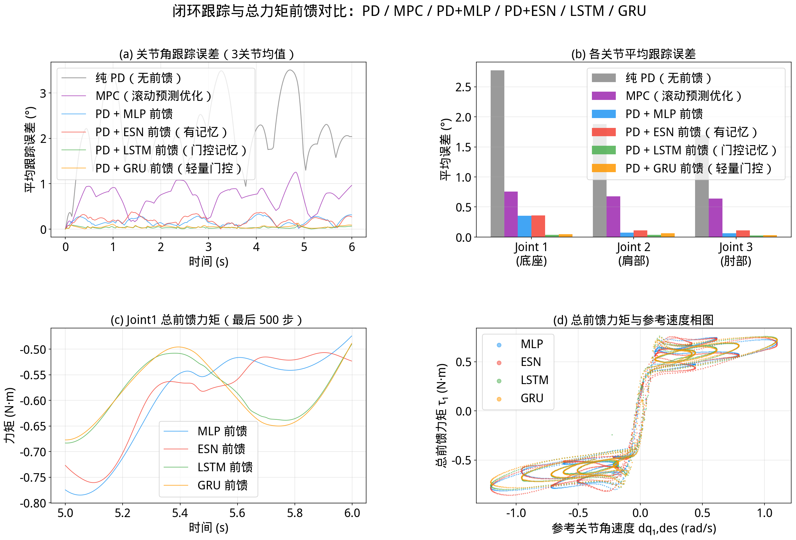

# RobotARMNN 多智能体审查、修复与仿真记录

整理日期：2026-11-10。审查基线：`45a8972`。三组分别检查 IK、控制与展示、模型与训练，并交叉只读审查；主智能体复核关键复现、集成测试与原生窗口。修复已获用户授权分批实施。

本页保留修复阶段及重训前旧权重的验证记录；后续八模型完整重训见 [重训记录](retrain_2026-11-10.md)，不要将本页旧权重数字当作当前 checkpoint 的结果。

## 当前控制任务

项目通过力矩控制实现位置轨迹跟踪：

```text
tau = tau_ff(q_des, dq_des, history)
    + KP * (q_des - q) + KD * (dq_des - dq)
```

现有 MLP、ESN、LSTM、GRU 都学习高增益 PD 示教总命令 `outputs`。ESN 的状态只接收参考位置、速度历史，不直接接收实际状态或误差。总命令包含惯性、重力、摩擦和示教误差的影响，不能把网络直接解释成纯摩擦残差。

`outputs_inv` 是指定参考加速度的逆动力学力矩，使用九维 `inputs_full`；`outputs_bg` 是参考加速度为零时的补偿力矩，使用六维 `inputs`。前一轮的标签版本 2 修复仍有效，本轮没有重新生成数据或覆盖权重。

## 已复现并修复

| 范围 | 缺陷与影响 | 修复和验证 |
|---|---|---|
| IK 采样 | 四个采样器把数组列表长度当作有效点数；8000 点对应 8000 批、1.92 亿候选 | 累计有效点数，单批最多 8192；默认 2D/3D 分别只需 13310/17767 个候选，与旧随机流的前 8000 点一致。零点返回正确空数组，负数和空采样域明确报错 |
| IK 解算 | 3DOF 批量求解漏查关节限位，单点与批量分支不同；其他自定义限位也可能被绕过 | 单点、批量共用双精度候选求解，检查全部关节，优先分支不合法时尝试备用肘分支；补上负水平半径及轴向自由 yaw 的合法解 |
| MJCF 单位 | 普通两份 XML 未声明弧度，加载后 ±π 被解释为 ±0.054831 rad | 两份文件补 `compiler angle="radian"`，直接加载检查限位；IDyn 的 friction XML 原已正确 |
| NN IK 输出 | NN 合法标记全为真，超限输出也显示为成功；实时窗口直接接受，缺权重可静默回退解析 | 原始 sin/cos 与解码角均检查有限及限位；非法误差记 NaN，单独报合法解率；四条实时路径拒绝非法姿态并提示，缺模型终止该模式；旧 viewer 无叠字 API 时保留控制台提示 |
| 控制组合 | 把学习总力矩的 GRU 再叠加到 MPC 总力矩，误称摩擦残差 | 禁用 `mpc_gru` 并说明需要定义残差后重训；保留独立 MPC 和 PD+GRU 比较 |
| 动力学展示 | 可能显示错误方案，参考球不随轨迹更新，模型与 viewer 共享，状态与参考错开一积分步 | `--viewer-model` 显式选择实际启用方案；独立渲染模型/数据，参考球由 MuJoCo FK 更新，显示与日志取积分前同刻；场景加锁，关闭窗口停止并裁剪日志，异常也清理资源 |
| 展示节奏 | 500 Hz 每步同步 viewer 遇到 60 Hz 垂直同步，会显著放慢运动 | 画面约 60 Hz 更新，物理控制仍每步 500 Hz；按绝对墙钟对齐播放节奏，显示抽样不改变控制轨迹 |
| 模型加载 | 可视化直接读取 CUDA 存储的旧 checkpoint，CPU 机器无法加载 | CLI 明确 `map_location="cpu"`，隐藏 CUDA 的子进程回归通过 |
| IK 训练 | ESN 用全量数据估计输入标准化，验证集泄漏 | 只用训练集统计，最佳 checkpoint 的统计不再被全量数据覆盖 |
| IDyn 验证 | MLP 按帧划分，递归模型按轨迹划分；RNN 分块清零评分与部署连续状态不一致 | 所有模型使用末尾 20% 完整轨迹验证，标准化只用训练轨迹；统一每条前 100 步不计 loss/评分；RNN 验证完整连续运行并保留尾部 |
| 训练边界 | `epochs=1` 导致余弦调度除零；RNN 忽略 CLI batch | 修复调度周期，显式 batch 生效；MLP/ESN CLI 默认 65536，LSTM/GRU 默认 256 |
| Checkpoint | ESN 把最大矩阵元素当谱半径，缺任务、划分与数据来源记录 | 保存正确谱半径；旧文件加载完整储层后重算一次，新存取保留预测；新增任务、输入、采样周期、数据哈希、轨迹 ID、预热/评分协议元数据 |

关键复现：目标 `[0.1, 0, 0.05]` 原批量 3DOF 肩角为 `-1.70448 rad`，超过 `-π/2`；修复后尝试另一肘分支。自定义底座限位 `[-0.1,0.1]` 时，合法角 `(0,1.4,0.8)` 的目标原被判不可达，现能重构合法解。

还纠正了说明：Coulomb 摩擦损失加线性阻尼没有独立迟滞状态，不等同完整 Stribeck 模型；总前馈力矩对速度的环状图不能单独证明摩擦迟滞。MPC 当前为无约束二次优化后首步限幅；CTC 类采用刚体前馈加力矩域 PD，未改其控制律。

## 验证与结果

最终全套 **115 项通过**（4.59 秒），`git diff --check` 通过。回归覆盖运动学、标签物理一致性、多项式模型、训练协议与展示。复现与测试命令：

```bash
OPENBLAS_NUM_THREADS=1 OMP_NUM_THREADS=1 MPLBACKEND=Agg uv run --no-sync pytest tests/ -q
MPLBACKEND=Agg uv run --no-sync src/visualize.py ik --arm all --n_test 8000 --seed 42
MPLBACKEND=Agg uv run --no-sync src/visualize_idyn.py --traj_seed 999 --amp_scale 1
```

4090 上另做六路单轮小网络训练（IK MLP/ESN、IDyn MLP/ESN/LSTM/GRU），使用独立数据与输出目录，仅在该验证进程旁路 `torch.compile`，验证训练、单轮调度、存取与元数据，不作为精度实验。原有全部 `.pt` 和 `data/idyn_3dof.npz` 的 SHA-256 不变。真实旧 ESN 保存副本再重载后，谱半径约 0.9、预测逐元素一致。

8000 点 IK（seed=42），误差仅统计合法输出：

| 模型 | 2DOF 合法解率 | 均值／p95 (mm) | 3DOF 合法解率 | 均值／p95 (mm) |
|---|---:|---:|---:|---:|
| 解析 | 100% | 0.000／0.00 | 100% | 0.000／0.00 |
| MLP | 100% | 0.920／2.08 | 7559/8000（94.4875%） | 0.628／1.39 |
| ESN | 100% | 6.654／13.07 | 7637/8000（95.4625%） | 3.986／8.15 |

3DOF 是球壳广域压力测试，包含需要负肘分支的正肘训练域外目标；合法解率也不等同于误差阈值内的成功率。默认 2D/3D 各 10 万个合法 FK 点的逆解复核均成功，最大重构误差约 `6.8e-8 m`。

真实闭环使用 `ctrl` 和 `mj_step`，500 Hz、每条 6 秒，现有权重 CPU 单线程推理，全部时刻和三个关节平均绝对角误差：

| seed／幅值 | PD | MPC | PD+MLP | PD+ESN | PD+LSTM | PD+GRU |
|---|---:|---:|---:|---:|---:|---:|
| 999／1 | 2.116980° | 0.688953° | 0.164084° | 0.193538° | 0.033558° | 0.047168° |
| 1000／1 | 2.186172° | 0.708155° | 0.203496° | 0.219970° | 0.049211° | 0.051421° |
| 1001／1 | 2.297333° | 0.786457° | 0.168169° | 0.206448° | 0.039566° | 0.052088° |
| 三条幅值1均值 | 2.200162° | 0.727855° | 0.178583° | 0.206652° | 0.040778° | 0.050226° |
| 999／2（增幅测试） | 2.433016° | 0.772381° | 0.275527° | 0.321301° | 0.111550° | 0.069463° |

四组六方案数值有限、积分后无关节越界、无命令饱和；`mj_step` 返回阶段接触记录为零，没有监测全部内部 RK4 子阶段。修复后的有效控制方案在 seed=999 两种幅值下与保存基线逐元素一致。ESN 改善 PD，但三条幅值1轨迹均弱于 MLP，不能据此声称独立摩擦记忆优势。结果也不代表器件精度或全工作空间泛化。



图为 seed=999、幅值1；相图使用与总前馈对应的参考速度，不作迟滞因果证明。

## 原生窗口与运动录像

```bash
uv run --no-sync src/visualize_idyn.py --model esn --amp_scale 1 --mujoco --viewer-model esn
```

已实际打开修复后的原生窗口，核对完整机械臂、当前方案、同刻误差及参考红球。窗口执行真实力矩控制积分；IK 查看器只设置 `qpos` 后调用 `mj_forward`，两种用途已明确区分。

本机证据位于 Git 忽略目录 `export/audit_simulation/`：

- `esn_live_simulation.mp4`：修复后原生 ESN 动力学窗口录屏，1300×1000、20 fps、12 秒；画面标有 Dynamics simulation。其采集时仍逐步同步 viewer，因此画面中的仿真时间慢于录像墙钟；后续显示抽帧修复不改物理轨迹。
- `esn_live_simulation_realtime.mp4`：刷新修复后的最终原生窗口录屏，1300×1000、20 fps、7 秒；已核对仿真时间基本跟随墙钟，控制500 Hz、显示约56 Hz。另一次最终30秒完整原生运行正常结束，PD/ESN平均误差为2.222°/0.186°。
- `dynamics_replay_pd_esn_gru.mp4`：真实闭环结果的 18 秒对比回放，画面明确标 Dynamics replay。
- `replay_viewer.py`：查看完整真实记录；`1` PD、`2` ESN、`3` GRU、`4` MLP、`5` LSTM、`6` MPC，空格暂停，`A` 自动轮换，`R` 重播；青色为参考姿态。
- `baseline_seed*.npz/.json`、`baseline_summary.json`：实际位置、速度、命令、执行力矩、接触与源码/权重哈希。
- `control_regression_comparison.json`、`control_cadence_regression.json`、`ik_fix_validation.json`：修复前后逐点一致性、显示抽帧、采样计数及合法率。
- `learning_smoke_tc2ec4dk/report.json`：隔离 GPU 训练、旧权重与数据哈希核对记录。

## 剩余实验边界

现有模型未按新训练协议正式重训，旧验证 MAE 已从 README 的公平横比中移除。RNN 仍保留独立块零状态训练，训练尾部不足完整块时丢弃；这已记录在 metadata 中，不等同整轨迹 BPTT。

若目标变为专门验证器件对摩擦非线性的补偿，需要另定义可观测、与基模型一致的摩擦残差标签和输入，再做无补偿／静态模型／ESN 的闭环对照。本轮没有创建该新任务或覆盖已有实验资产。
