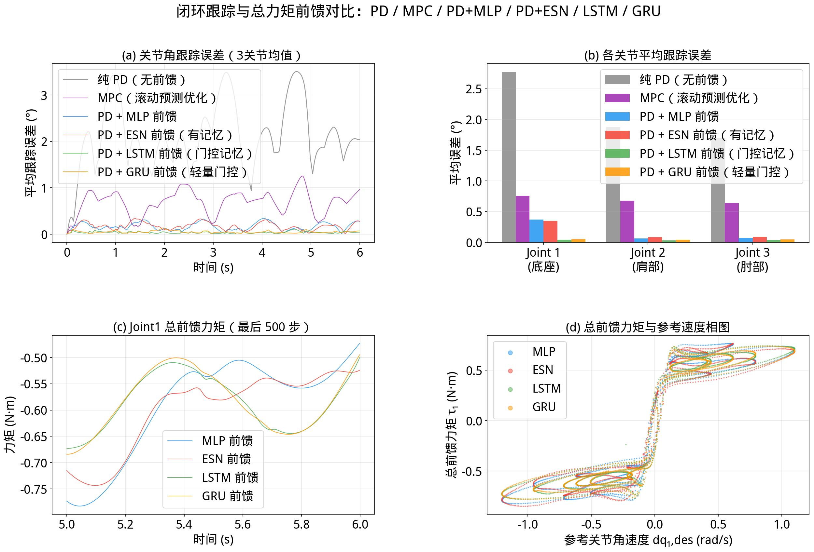

# 2026-11-10 八模型完整重训与结果复核

本次按修复后的训练协议重新训练当前入口使用的四个 IK、四个 IDyn 模型，保持新旧网络规模一致。原权重先归档，新权重只按验证集选择；测试结果没有参与训练或调参。重训没有保证所有指标改善，新旧结果均保留。

## 数据与训练设置

使用 RTX 4090 24 GB、PyTorch 2.11.0+cu130；每个模型开始前独立重置 Python、NumPy、PyTorch 和 CUDA 种子为 42。MLP 保留 `torch.compile`；ESN 和 RNN 沿用现有训练实现。新 checkpoint 最终保存为 CPU 张量，附带数据哈希、训练参数与来源元数据；固定种子不等同跨版本、跨设备位级一致。

| 模型 | 架构 | 轮数 | batch | 学习率 |
|---|---|---:|---:|---:|
| IK 2DOF MLP | 3×256 | 500 | 65536 | 3e-4 |
| IK 2DOF ESN | 储层512＋读出128 | 300 | 65536 | 1e-3 |
| IK 3DOF MLP | 3×256 | 500 | 65536 | 3e-4 |
| IK 3DOF ESN | 储层512＋读出128 | 300 | 65536 | 1e-3 |
| IDyn MLP | 4×256 | 1000 | 65536 | 3e-4 |
| IDyn ESN | 储层512＋读出128，谱半径0.9 | 1000 | 65536 | 1e-3 |
| IDyn LSTM | 4层×256，训练块200步 | 1000 | 256 | 1e-3 |
| IDyn GRU | 4层×256，训练块200步 | 1000 | 256 | 1e-3 |

三份原数据保持不变：IK 2DOF 为 500000 点（450000/50000），IK 3DOF 为 396651 点（356986/39665），按现有固定 CUDA 划分种子42划分。标准化只使用训练输入。

IDyn 使用版本2、seed42、500 Hz、30条×4000步，共120000帧。轨迹0–23训练、24–29验证；每条前100步仅用于状态建立，不计训练损失或验证分数，损失样本93600/23400。MLP/ESN统一使用这些轨迹；LSTM/GRU仍为独立块零状态训练、完整轨迹连续验证。本数据长度能被200整除，无不完整训练尾块。所有网络学习 `inputs → outputs` PD示教总力矩，不是 `outputs_bg` 或纯摩擦残差。

数据生成器复算30条参考位置、速度、加速度均与文件一致；当前XML复算第0条PD轨迹一致，抽样逆动力学标签差不超过约6e-8。数据SHA-256、新旧checkpoint哈希、训练耗时、精确验证指标和评估结果保存在同名 [JSON记录](retrain_2026-11-10.json)。

## IK：固定目标的新旧对照

每臂每域均冻结8000点，所有模型共享目标。广域seed42延续修复前评估分布；共同域seed7777中，3DOF只保留正肘解析解本身合法、正水平半径大于1cm的目标，属于条件域，不等同于训练FK分布。2DOF环域已在正肘合法范围内，使用独立种子复核。

误差仅统计有限且满足全部关节限位的输出，合法率单报；成功率以全部8000点为分母，非法输出一律失败。

| 广域 | 模型 | 旧均值／p95 (mm) | 新均值／p95 (mm) | 新合法率 |
|---|---|---:|---:|---:|
| 2DOF | MLP | 0.920／2.076 | 1.015／2.316 | 100% |
| 2DOF | ESN | 6.654／13.067 | 6.504／12.241 | 100% |
| 3DOF | MLP | 0.628／1.394 | 0.637／1.452 | 94.4625% |
| 3DOF | ESN | 3.986／8.154 | 4.218／8.731 | 95.2125% |

| 共同域新权重 | 合法率 | 均值／p95 (mm) | ≤1mm成功率 | ≤5mm成功率 |
|---|---:|---:|---:|---:|
| 2DOF MLP | 100% | 1.015／2.384 | 59.2875% | 99.9750% |
| 2DOF ESN | 100% | 6.417／12.049 | 2.6375% | 34.6375% |
| 3DOF MLP | 99.925% | 0.644／1.482 | 81.6750% | 99.9250% |
| 3DOF ESN | 99.85% | 4.172／8.629 | 4.7500% | 69.9625% |

这些结果没有显示整体IK提升；单个种子的新旧差异也不能单独归因于标准化修复。新旧3DOF MLP均为3×256，修正的是旧README的架构描述，没有降低网络容量。

## 验证集与独立闭环结果

训练从北京时间00:48:32至01:03:12，总计约14分40秒。各模型耗时约为：IK2 MLP14.13秒、ESN2.77秒，IK3 MLP8.02秒、ESN2.26秒，IDyn MLP8.03秒、ESN4.91秒、LSTM421.37秒、GRU417.77秒；包含相应构建、编译、选模及存取。峰值PyTorch分配显存约1810MiB，不含桌面、其他进程及CUDA上下文占用。

保存后全部用CPU单线程、float32推理复算；IDyn每条验证轨迹从零状态连续运行，首100步不评分。验证集参与选模，这些数值不是独立测试成绩：

| 模型 | 验证 MAE | 验证 MSE |
|---|---:|---:|
| IK2 MLP | 0.551795° | sin/cos 0.000211388 |
| IK2 ESN | 3.095236° | sin/cos 0.003901079 |
| IK3 MLP | 0.364102° | sin/cos 0.000116467 |
| IK3 ESN | 2.516338° | sin/cos 0.003177825 |
| IDyn MLP | 0.048702 N·m | 0.004754463 N²·m² |
| IDyn ESN | 0.052703 N·m | 0.005841873 N²·m² |
| IDyn LSTM | 0.011552 N·m | 0.000291612 N²·m² |
| IDyn GRU | 0.011052 N·m | 0.000279952 N²·m² |

IK3角度误差只统计实际学习的θ2、θ3；端点误差仍使用毫米单报。CPU与训练时GPU浮点实现存在小量数值差异。

独立闭环复用审查阶段冻结的4条参考轨迹，500Hz、每条6秒；位置初值、PD增益、模型物理参数一致，PD/MPC与旧轨迹逐元素相同。全部时刻和3关节的平均绝对角误差：

| seed／幅值 | PD | MPC | PD+MLP | PD+ESN | PD+LSTM | PD+GRU |
|---|---:|---:|---:|---:|---:|---:|
| 999／1 | 2.116980° | 0.688953° | 0.165577° | 0.172581° | 0.036365° | 0.046960° |
| 1000／1 | 2.186172° | 0.708155° | 0.193338° | 0.205947° | 0.058838° | 0.053402° |
| 1001／1 | 2.297333° | 0.786457° | 0.171004° | 0.201973° | 0.042436° | 0.045516° |
| 三条幅值1均值 | 2.200162° | 0.727855° | 0.176639° | 0.193500° | 0.045880° | 0.048626° |
| 999／2（增幅） | 2.433016° | 0.772381° | 0.264399° | 0.287962° | 0.107920° | 0.061780° |

| 方案 | 旧幅值1均值 | 新幅值1均值 | 相对变化 |
|---|---:|---:|---:|
| MLP | 0.178583° | 0.176639° | -1.09% |
| ESN | 0.206652° | 0.193500° | -6.36% |
| LSTM | 0.040778° | 0.045880° | +12.51% |
| GRU | 0.050226° | 0.048626° | -3.19% |

ESN有所改善但仍弱于MLP，LSTM本次重训退步；不能把训练划分、选模协议与随机初始化共同变化的结果全归因于某一修复或网络机制。24次运行均有限，积分后关节越界0、命令饱和0，最大绝对命令约1.115N·m；返回阶段接触数0，不覆盖RK4全部内部子阶段。评估输入与训练/验证没有精确float32行或整段参考前缀重叠，不据此声称跨分布泛化。

全套115项回归通过，`git diff --check`通过；八个文件均为CPU存储、张量有限、元数据及数据哈希正确，与归档架构逐张量形状一致。桌面回放窗口已切换为本次新权重的真实积分记录，并明确标注Retrained dynamics replay；本地录像为 `export/retrain_20261110/retrained_dynamics_replay.mp4`。

## 文档改动的意义

`CLAUDE.md` 中的通用规则已在本机全局文件保留，仓库文件集中描述项目地图与项目规范，并明确全局文件不随仓库分发。此次同时更正完整增益数组、碰撞排除范围及总力矩目标，移除常用命令中的破坏性回滚速查。

README改正了3DOF MLP架构、测试增益数组与角度/位置误差的单位混淆，并以实际测量替换旧时长估计。原审查页保留为重训前历史证据，配图也单独保留，避免与当前权重结果混淆。这些改动有助于复现和正确解释任务。

本地完整日志、训练驱动、旧权重及冻结目标位于Git忽略目录 `export/retrain_20261110/`；正式结果与新权重随本次项目更新提交。八个当前模型之外的历史兼容资产没有参与本次评估。
